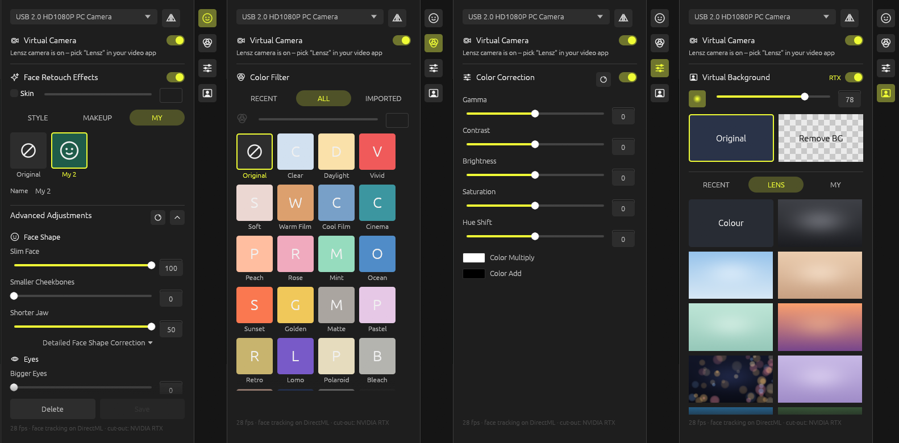

# Lensz

**A free, open-source alternative to PRISM Lens: no login, no watermark, works offline.**

Lensz is a Windows camera app written in Rust. It reshapes and retouches your face, adds makeup
and colour filters, replaces or blurs your background, and offers the result as a camera called
**Lensz**, which you can pick in Zoom, Teams, Google Meet, Discord, OBS and other video apps.

Everything runs on your PC. Lensz needs no account, no internet connection and adds no watermark.



## Features

| Menu | What it does |
|---|---|
| **Face Retouch** | Styles, makeup looks and your own saved presets (MY). Skin smoothing, plus face-shape sliders: slim face, cheekbones, jaw, V-jaw, smaller face or head, eyes, nose and mouth. Also dark circles, nasolabial folds and teeth whitening. |
| **Color Filter** | 25 built-in looks, plus your own `.cube` or 512×512 PNG LUTs, with a strength slider. |
| **Color Correction** | Gamma, contrast, brightness, saturation, hue, and colour multiply/add. |
| **Virtual Background** | Background blur, *Remove BG* (green screen), 14 built-in backgrounds, your own pictures, and Portrait Light. On NVIDIA RTX cards with NVIDIA's Video Effects SDK installed, it uses NVIDIA's AI Green Screen for the cut-out. |
| **Virtual Camera** | The **Lensz** camera for other apps. It stays listed when the app is closed and shows an "Open the Lensz app" picture until you open Lensz. |
| **Tray** | Closing the window keeps Lensz running in the notification area. Right-click the icon to open the window, switch the camera or quit. |

## Install

1. Download `LenszSetup-<version>.exe` from [Releases](../../releases).
2. Run it and accept the admin prompt. The prompt is needed because the cameras are registered for the whole PC.
3. Optional: choose **Start Lensz in the tray when Windows starts**, so the camera is always ready.

Lensz needs **Windows 11 (x64)**. A DirectX 12 GPU is recommended, because face tracking and
background removal run on the GPU through DirectML. The installer adds the Microsoft Visual C++
runtime if it's missing.

To uninstall, go to **Settings → Apps → Installed apps → Lensz → Uninstall**. This removes both
cameras and the startup entry, and keeps your presets in `%APPDATA%\LensRS`.

## Using Lensz in other apps

1. Open Lensz and set up your look. The window shows exactly what others will see.
2. In your video app, choose the Lensz camera:
   - **Zoom, Teams, Chrome/Edge (Meet), Windows Camera:** **Lensz (Windows Virtual Camera)**.
   - **OBS** and older apps that list only DirectShow cameras: **Lensz**.
3. To keep the camera running without the window, close the window. Lensz stays in the tray.

Only one app can use your real webcam at a time. If Lensz shows *"No picture from the camera"*,
close the other camera app (for example PRISM Lens, or Zoom set to the real webcam).

## Documentation

- [User guide](docs/user-guide.md): every menu and setting.
- [Architecture](docs/architecture.md): how the face tracking, rendering and cameras work.
- [Building from source](docs/building.md): toolchain, build, installer, test flags.
- [Troubleshooting](docs/troubleshooting.md)

## Build from source (short version)

You need Rust (stable, MSVC), Visual Studio 2022 with the C++ workload, and Inno Setup 6. Then run:

```powershell
cargo run --release                                          # run the app
powershell -ExecutionPolicy Bypass -File installer\build.ps1 # build installer\output\LenszSetup-<version>.exe
```

See [docs/building.md](docs/building.md) for details.

## Project layout

```
src/            the app (egui UI, capture, tracking, GPU rendering, cameras, tray)
vcam/           lens_vcam.dll – the Windows 11 virtual camera media source
third_party/    softcam – the DirectShow camera (lensz_dshow.dll), modified, MIT
models/         ONNX models (MediaPipe face detector, landmarks, selfie segmenter)
installer/      Inno Setup script, build script, icon, third-party notices
tools/          helper scripts (window capture)
docs/           documentation
```

## Licences

Lensz is released under the [MIT License](LICENSE). For the third-party components and their
licences (MIT, Apache-2.0, SIL OFL), see [installer/THIRD_PARTY_NOTICES.txt](installer/THIRD_PARTY_NOTICES.txt)
and [models/NOTICE.md](models/NOTICE.md).

Lensz is an independent project. It is not affiliated with, endorsed by or connected to NAVER,
PRISM Live Studio or PRISM Lens; those names are trademarks of their owners and are mentioned only
for comparison. Lensz contains no code, models, filters or other files from PRISM Lens.
